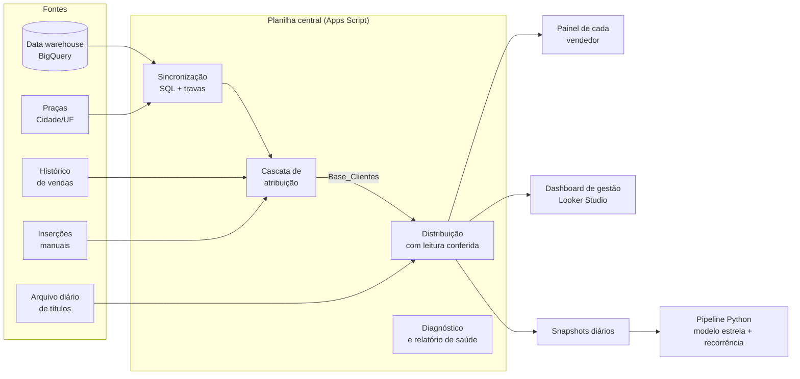
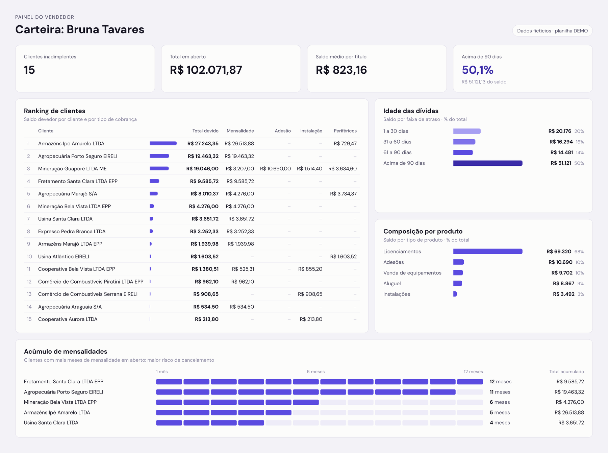
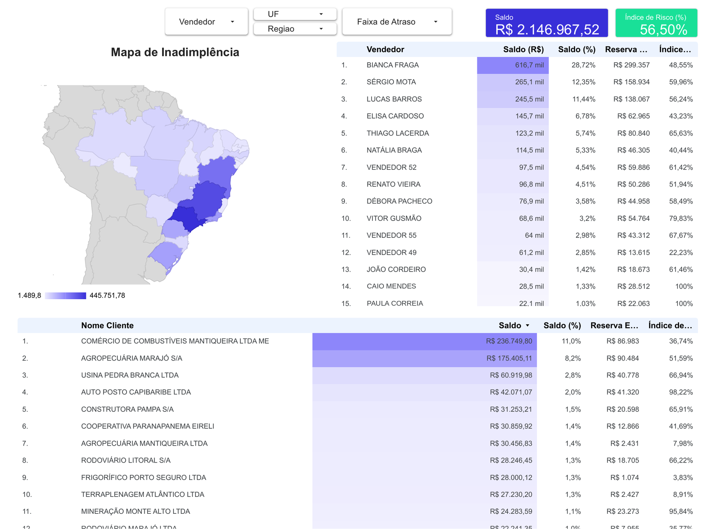
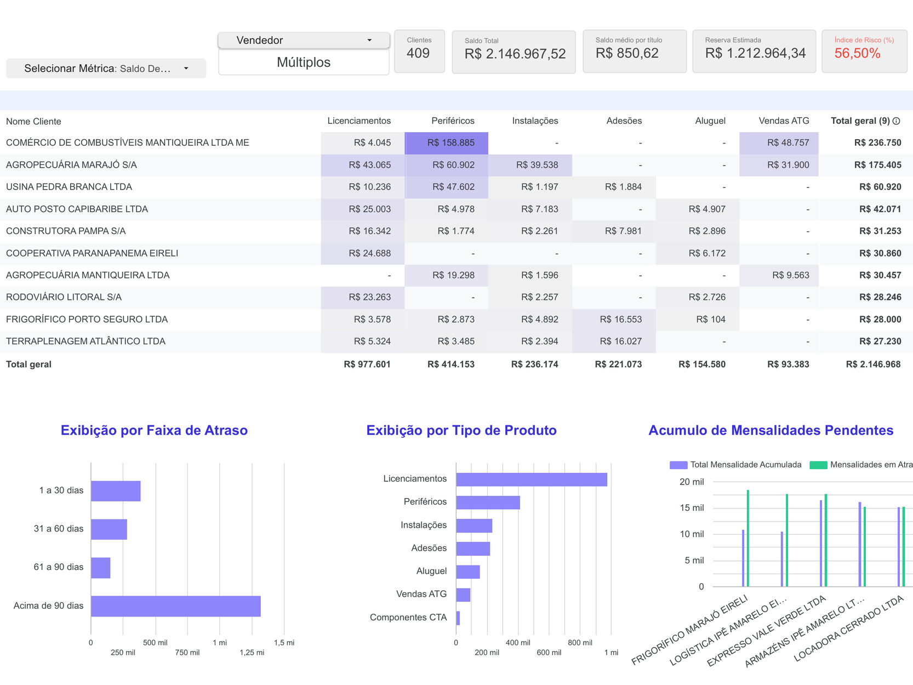
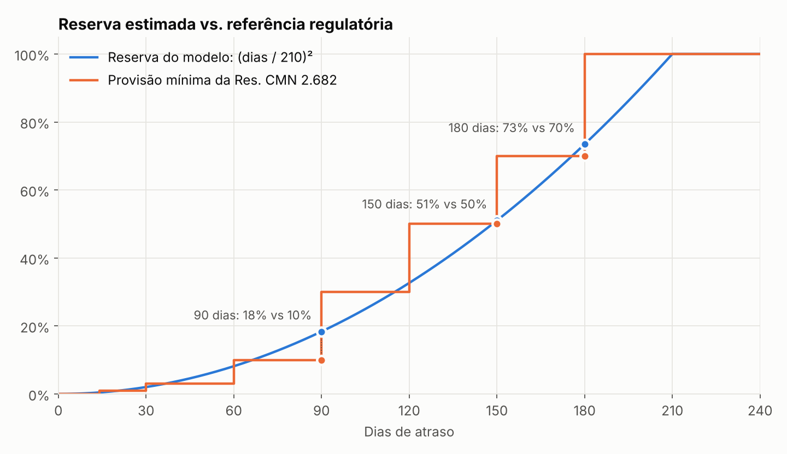
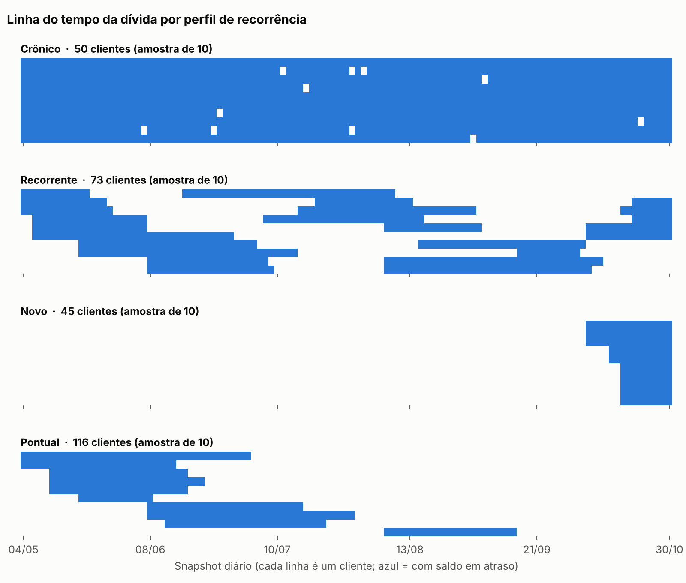
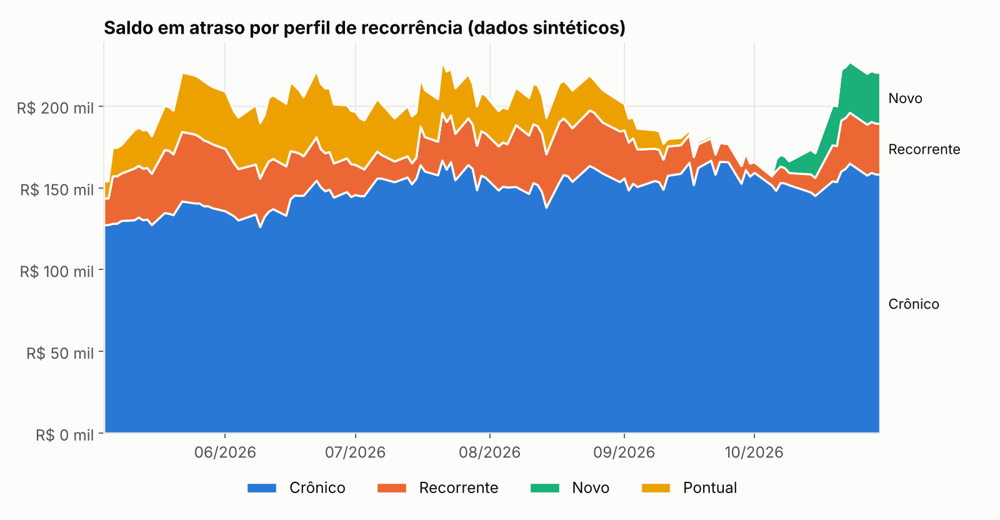

# Inadimplência por carteira comercial


O projeto distribui diariamente os títulos em atraso de uma empresa B2B entre os vendedores responsáveis por cada cliente. Também mede o risco da carteira e acompanha a recorrência da dívida ao longo do tempo.

> *English summary at the end.* Todo dado deste repositório é **sintético**. O código foi sanitizado: os IDs de planilhas, o projeto de nuvem e os nomes de pessoas e clientes foram trocados por exemplos.

---

## O problema

O financeiro precisava cobrar a inadimplência **por carteira de vendedor**, mas a empresa **não tinha uma lista de qual vendedor era dono de cada cliente**. A informação estava espalhada em quatro lugares:

| Fonte | O que traz | Limitação |
|---|---|---|
| ERP (data warehouse no BigQuery) | Cadastro de ~4.500 clientes, cidade e UF | Não diz quem é o vendedor |
| Histórico de vendas | Quem vendeu o quê, para qual CNPJ | Filiais e grupos com CNPJs diferentes; vendedores que saíram |
| Planilha de praças | Cidade/UF → vendedor regional | Grafias diferentes do ERP ("Moji" × "Mogi") |
| Arquivo diário de títulos em atraso | Saldo, vencimento e produto | Atualizado de hora em hora por outro processo |

## A solução



### 1. Cascata de atribuição: de quem é este cliente?

Cada cliente passa por regras em ordem de confiança e para na primeira que resolve. A regra usada fica gravada ao lado do vendedor, então qualquer gestor consegue auditar o porquê de cada atribuição.

| # | Regra | Exemplo |
|---|---|---|
| 1 | Inserção manual (CNPJ exato ou do grupo) | Exceções definidas pela gestão |
| 2 | Histórico de vendas pela **raiz do CNPJ** | Uma filial nova herda o vendedor da matriz |
| 3 | Razão social exata e parcial | O mesmo cliente cadastrado com outro CNPJ |
| 4 | **Praça**: cidade + UF → vendedor regional | Cliente sem histórico de venda |
| 5 | Retenção (vendedor inativo) | Mantém o cliente visível até ser redistribuído |
| 6 | **Grande conta**: quem paga os equipamentos instalados em um cliente da carteira de grandes contas vai junto | Um grupo paga os equipamentos das filiais |

Também há controles manuais paralelos: um vendedor de parcerias que só recebe o que for inserido à mão, a marcação `REGIONAL` para forçar a praça e a marcação `SEM GRANDE CONTA`. Detalhes em [docs/regras_atribuicao.md](docs/regras_atribuicao.md).

**Resultado:** 99,9% dos ~4.500 clientes passaram a ter um responsável. Os que ficam sem dono aparecem nominalmente no relatório.

### 2. Distribuição diária com travas

O arquivo de origem é atualizado de hora em hora por outro processo, e a leitura poderia pegar o arquivo pela metade. Por isso, a distribuição só aceita a leitura se:

- a soma do saldo bate com o total do próprio arquivo;
- o número de títulos não caiu mais de 30% em relação à execução anterior;
- ou, se o total não bater, duas leituras seguidas dão o mesmo resultado (o arquivo está estável).

Cada vendedor recebe a própria planilha, criada a partir de um template e atualizada pela distribuição. Ela traz o ranking dos clientes da carteira, o aging, a composição da dívida por produto e os clientes com mais mensalidades acumuladas:



<sub>Painel de um vendedor fictício. Os dados foram embaralhados pelo `Randomizador.gs`.</sub>

Se nenhuma condição da leitura conferida for atendida, a distribuição espera, tenta de novo e, no limite, aborta sem alterar nada. Um diagnóstico confere versões dos scripts, acessos, gatilhos, frescor das bases e consistência, e grava tudo em uma aba de saúde.

> **Um bug que vale contar:** a soma lida era cinco vezes maior que o total do próprio arquivo, e as células estavam todas certas. O total era um `SUBTOTAL(9;F:F)`, que só soma as linhas **visíveis**, e um filtro na aba escondia 7 tipos de produto. Em vez de desligar a checagem, o script passou a reproduzir o filtro da origem, sem alterá-lo, e a comparar as duas somas.

### 3. BI para a gestão: risco da carteira

O dashboard de gestão (Looker Studio) mostra o aging, a carteira por vendedor, a concentração por cliente e produto, e o **Índice de Risco**:





<sub>Dashboard de gestão no Looker Studio, ligado à cópia anonimizada dos dados (nomes, documentos e valores embaralhados).</sub>

O Índice de Risco é uma reserva estimada que cresce de forma quadrática com os dias de atraso, comparada com a tabela da Resolução CMN 2.682:



As definições das métricas (a camada semântica) estão em [docs/camada_semantica.md](docs/camada_semantica.md), e a justificativa da curva em [docs/modelo_risco.md](docs/modelo_risco.md).

### 4. Pipeline Python: linha do tempo e recorrência da dívida

Os snapshots diários viram um **modelo estrela** (fatos de título, cliente-dia e episódio, mais as dimensões de cliente, vendedor, produto e data). Um **episódio** é um período contínuo com saldo em atraso; ausências de até 2 snapshots não o encerram. Cada cliente recebe uma classe:

| Classe | Critério |
|---|---|
| **Crônico** | Presente em ≥ 80% dos snapshots desde que apareceu (mínimo de 20) |
| **Recorrente** | Dois ou mais episódios |
| **Novo** | Apareceu pela primeira vez no último mês |
| **Pontual** | Um episódio, já encerrado ou ainda curto |





Nos dados sintéticos, a classificação recupera o perfil usado na geração em ~96% dos clientes, e os testes exigem ≥ 90%. As análises em SQL ficam em [sql/analises.sql](sql/analises.sql) e rodam com DuckDB sobre os arquivos Parquet. O modelo está documentado em [docs/modelo_dados.md](docs/modelo_dados.md).

## Como rodar

```bash
python -m venv .venv && source .venv/bin/activate
pip install -e ".[dev]"

python -m inadimplencia demo          # gera ~110 snapshots sintéticos, monta o modelo e roda as análises SQL
pytest                                # 46 testes
python scripts/gerar_figuras.py       # refaz as figuras deste README
```

Com dados reais, os snapshots ficam em uma pasta do Google Drive e são lidos por uma conta de serviço:

```bash
pip install -e ".[drive]"
python -m inadimplencia baixar --pasta-id <ID> --credenciais conta-servico.json --destino data/snapshots
python -m inadimplencia processar --entrada data/snapshots --destino data/modelo
```

## Estrutura

```
apps_script/   motor de atribuição, distribuição, diagnóstico e anonimização (Google Apps Script)
sql/           extrações do data warehouse (BigQuery) e análises sobre o modelo estrela (DuckDB)
src/           pipeline Python: limpeza, modelo estrela, recorrência, risco, CLI
tests/         pytest (limpeza, risco, modelagem e ponta a ponta com dados sintéticos)
docs/          regras de negócio, modelo de dados, camada semântica e figuras
scripts/       geração das figuras
```

## Decisões técnicas

- **Apps Script na operação, Python na análise.** A operação vive no Google Workspace: os vendedores abrem as próprias planilhas e a gestão abre o Looker. Por isso, o motor roda dentro da planilha, sem servidor. A análise histórica, que precisa de modelagem e testes, foi para Python.
- **Toda atribuição é auditável.** A regra usada fica gravada ao lado do vendedor, e um relatório mostra quantos clientes caíram em cada regra. Assim, a gestão consegue conferir e contestar cada caso em vez de confiar em uma caixa-preta.
- **Falhar sem estragar.** Nenhuma sincronização limpa uma base se a fonte voltar vazia, e a distribuição aborta antes de escrever se a leitura não for conferida.
- **Dados de demonstração gerados no próprio código.** Os scripts de anonimização (`AnonimizarDemo.gs`, `Randomizador.gs`) e o gerador sintético (`sintetico.py`) permitem mostrar o projeto sem expor clientes.

## Stack

Google Apps Script (JavaScript) · BigQuery (SQL) · Looker Studio · Python (pandas, NumPy, DuckDB, PyArrow, matplotlib) · pytest · GitHub Actions

---

## English summary

A B2B company needed to collect overdue receivables **by sales portfolio**, but had no list of which salesperson owned each client. I built:

1. **An auditable attribution cascade** (manual overrides → CNPJ-root sales history → company name → city/state territory → key-account equipment payers) that assigns ~4,500 clients with 99.9% coverage. Each client carries the rule that assigned it.
2. **A daily distribution job** that reads a source file that is updated every hour, and only accepts a read that reconciles with the file's own total. It also includes a self-diagnostic report.
3. **A management dashboard** with a quadratic-reserve **risk index**, benchmarked against Brazil's CMN 2.682 provisioning table.
4. **A Python pipeline** that turns daily snapshots into a star schema and classifies each client's debt history as chronic, recurring, new or one-off. SQL analytics run on DuckDB, with tests and CI.

All data in this repository is synthetic. Run `python -m inadimplencia demo` to reproduce everything.
