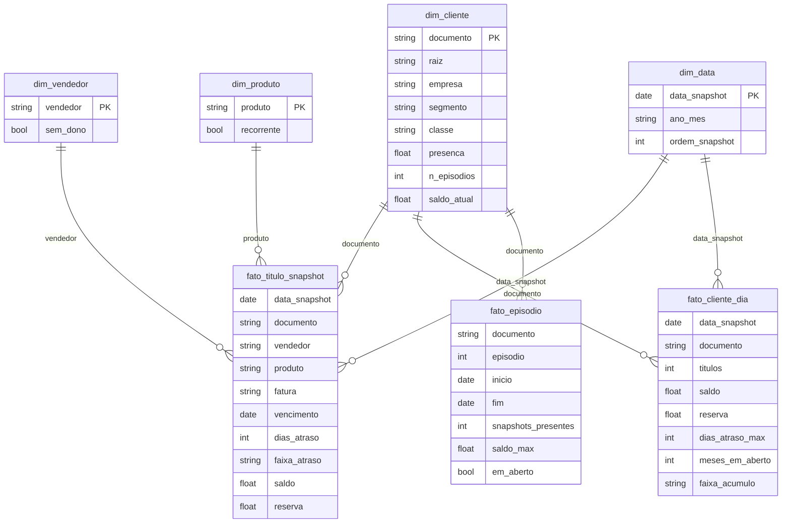

# Modelo de dados (estrela)

Gerado por [`src/inadimplencia/modelagem.py`](../src/inadimplencia/modelagem.py) e gravado em Parquet. As análises de [`sql/analises.sql`](../sql/analises.sql) rodam sobre essas tabelas com DuckDB.

## Grãos

| Tabela | Grão | Para que serve |
|---|---|---|
| `fato_titulo_snapshot` | título × dia | Aging, carteira por vendedor, reserva |
| `fato_cliente_dia` | cliente × dia | Linha do tempo, evolução, acúmulo de mensalidades |
| `fato_episodio` | episódio de atraso | Duração e frequência dos atrasos |
| `dim_cliente` | cliente | Perfil de recorrência (classe) e segmento |

## Decisões

- **Chaves naturais.** O documento (CNPJ/CPF normalizado), o nome do vendedor e a data são estáveis e legíveis. Para uma ferramenta de BI com poucas tabelas, chaves substitutas não trariam ganho.
- **A raiz do CNPJ fica na dimensão** e agrupa filiais de um mesmo grupo. A atribuição de vendedor também usa a raiz.
- **Snapshot, não evento.** A fonte é uma foto diária do contas a receber, sem registro de pagamento. Por isso, o pagamento é inferido: o título sai do arquivo. A tolerância de 2 snapshots evita que um arquivo incompleto encerre um episódio por engano.
- **Meses em aberto** contam os meses de emissão distintos só dos produtos recorrentes (mensalidades). É o que a cobrança chama de "acúmulo".
