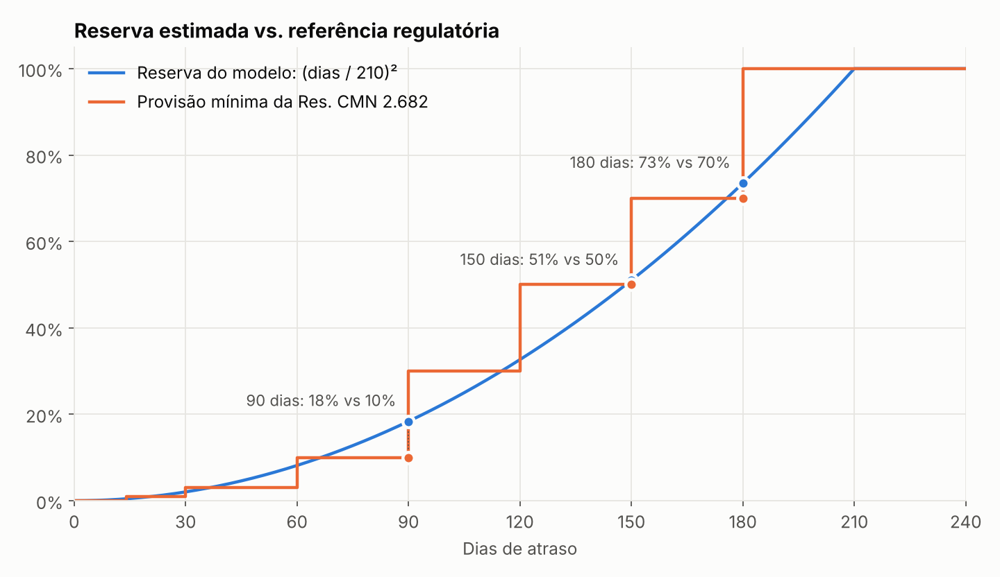

# Modelo de risco

## Pergunta de negócio

> Quanto desta carteira em atraso provavelmente não volta, e onde isso está concentrado?

Somar o saldo em atraso trata da mesma forma um título de 5 dias e um de 200. A gestão precisava de um número que pesasse o atraso.

## Definição

```
reserva(título) = saldo × (min(dias de atraso, 210) / 210)²
índice de risco = Σ reserva / Σ saldo
```

| Dias de atraso | Fator de reserva | Res. CMN 2.682 |
|---|---|---|
| 30 | 2% | 1% |
| 60 | 8% | 3% |
| 90 | 18% | 10% |
| 120 | 33% | 30% |
| 150 | 51% | 50% |
| 180 | 73% | 70% |
| 210+ | 100% | 100% (após 180) |



## Por que essa curva

- **É contínua.** A tabela regulatória é em degraus: um título salta de 10% para 30% de um dia para o outro. Em um dashboard diário, os degraus criam variações artificiais no índice. A curva quadrática muda suavemente.
- **É conservadora no meio da curva e converge com a tabela.** Até 90 dias, o modelo reserva mais do que o piso regulatório: atraso de mensalidade que passa de um mês costuma indicar problema real. Perto de 150 a 180 dias, os dois coincidem.
- **Tem um teto explicável.** Aos 210 dias (7 meses), o título é tratado como perda.
- **É fácil de explicar.** A regra cabe em uma frase: "metade do teto em dias equivale a 25% de reserva".

## Uso no dashboard

- O índice é calculado como `SUM(reserva) / SUM(saldo)`, nunca como média de índices. Assim, clientes grandes pesam proporcionalmente.
- Há uma versão do índice só para **cliente final**, que exclui distribuidoras. Elas têm outro padrão de pagamento e distorceriam a leitura.
- No mapa, a cor é o índice de risco (onde está o risco) e o saldo fica na dica de ferramenta (quanto está em jogo).

## Limitações

- Os parâmetros (teto de 210 dias, expoente 2) foram calibrados com a gestão. Não foram estimados a partir de perdas observadas. O histórico do pipeline Python é o primeiro passo para calibrá-los com dados de recuperação.
- O modelo olha só os dias de atraso. Ele não considera o perfil do cliente (crônico × pontual), que é candidato natural a um segundo fator.
